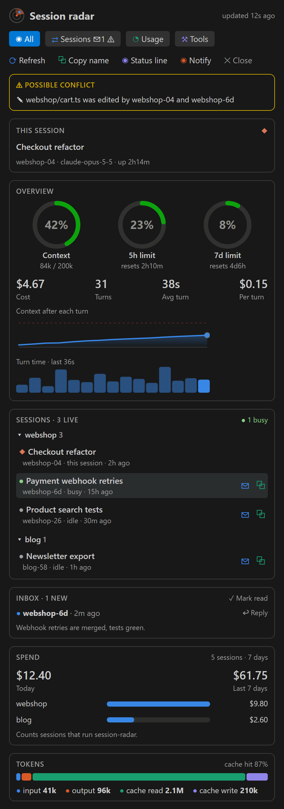
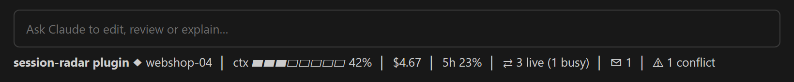

# session-radar

**A tiny mod that keeps an eye on every Claude Code session you have open, so
you don't have to.**

Four tabs open, four agents working. Which one is `webshop-6d`? Has the test
run finished yet? Are two of them editing the same file? session-radar answers
all three in a pane beside the chat, and taps you on the shoulder when
something needs you.

<p align="center">
  
</p>

```
/plugin install session-radar --marketplace iatila/session-radar
```

## A day with session-radar

**1. Two agents reach for the same file.** You asked one session to refactor
the cart and another to fix the checkout tests. Both open `cart.ts`. An amber
warning appears on top of the pane (as in the picture above), and a notification tells you before the
edits collide. Your agents hear about it too: when the second one goes to edit
`cart.ts` while the first is still working, that edit is refused once with
*"webshop-04 is still working and edited …/webshop/cart.ts 2m ago"*. The agent
re-reads the file and can message `webshop-04` first; repeating the edit goes
through.

**2. You stop checking tabs.** You switch to something else. When the test
session goes from busy to idle you get *"webshop-6d finished: Product search
tests"*. By default only sessions in the same project notify you; with three
or four VS Code windows open, switch **Finished notices** to `all-projects`
in `/config` and hear from every window while you work in one.

**3. One of them is waiting for you.** A session stops on a permission
question while you are in another tab. Its card appears at the top of the
pane (*"webshop-6d: Claude needs your permission to use Bash"*), a notification
tells you, and the status line shows *⏸ 1 waiting*. It disappears as soon as
you answer.

**4. Agents hand work to each other.** Press ⧉ next to a session to copy its
name, then tell your agent *"send the failing test output to `webshop-6d`"*.
Or press ✉ and type the message yourself, with no model call. The answer
lands in your Inbox.

All the while a one-line summary sits under the prompt:



## Why

When several Claude Code sessions run at once, agents can message each other
with `SendMessage`, but only by a peer name such as `webshop-6d`. Nothing on
screen tells you which editor tab that name belongs to, and the tab title
("Payment webhook retries") is not something an agent can address.

session-radar puts the two side by side: every open session, grouped by
project folder, shown by its tab title with its peer name underneath and a
Copy button.

## What it shows

| Card | Contents |
| --- | --- |
| **This session** | Tab title, peer name, model, uptime |
| **Overview** | Context fill, 5-hour and 7-day rate limits as gauges (green, then amber from 60 %, red from 85 %), time to reset; cost, turns, average turn time, cost per turn; context fill after each turn; duration of each turn |
| **Sessions** | Every open session on this machine, grouped by project folder: tab title, peer name, busy / idle, age, Copy. Your own session is marked ◆, busy ones ●. Offline Remote Control sessions are hidden behind a toggle |
| **Waiting for you** | Shown on top in red when another session is stopped on a permission question or a question to you: its name, project, what it asks and for how long. Gone when it carries on |
| **Possible conflicts** | Shown on top in amber when two sessions are busy in the same project folder at once, or when two sessions edited the same file in the last 30 minutes |
| **Inbox** | Messages other sessions sent to this one, newest first, with Reply |
| **Spend** | Today and the last 7 days across all your sessions, and today per project |
| **Tokens** | Input, output, cache read and cache write as a stacked bar, cache hit rate, subagent turns on their own line |
| **Tools** | The most used tools with call and error counts |

It tells you when something needs you, as a desktop notification (or a toast
where there is none):

- **A session finished**: another session went from busy to idle. Which
  sessions count is a setting (below): only this project's folder
  (default), or every open session in any project.
- **A session needs you**: another session stopped on a permission question
  or a question to you. Follows the same project scope as finished notices.
- **A possible conflict**: two sessions started working in the same folder,
  or touched the same file.
- **A message arrived**: a toast with the sender and the first line.

In the terminal the pane draws the same cards with text bars:

```
 ◎ Session radar                       updated 12s ago
 [◉ All] [⇄ Sessions ✉1 ⚠] [◔ Usage] [⚒ Tools]
 ⟳ Refresh   ⧉ Copy name   ◉ Status line   ◉ Notify   ✕ Close
╭ ⚠ POSSIBLE CONFLICT ───────────────────────────╮
│ ✎ …/webshop/cart.ts was edited by webshop-04   │
│   and webshop-6d                               │
╰────────────────────────────────────────────────╯
╭ THIS SESSION ──────────────────────────────── ◆ ╮
│ Checkout refactor                              │
│ webshop-04 · claude-opus-5-5 · up 2h14m        │
╰────────────────────────────────────────────────╯
╭ OVERVIEW ──────────────────────────────────────╮
│    ◔ 42%          ◑ 23%          ◔ 8%          │
│   Context       5h limit       7d limit        │
│  84k / 200k    resets 2h10m                    │
│                                                │
│  $4.67     31       38s        $0.15           │
│  Cost      Turns    Avg turn   Per turn        │
│  Context after each turn  ▁▂▂▃▃▄▅▅▆▆           │
╰────────────────────────────────────────────────╯
╭ SESSIONS · 4 LIVE ──────────────────── ● 1 busy ╮
│ ▾ webshop 3                                    │
│   ◆ Checkout refactor                          │
│     webshop-04 · this session · 2h ago         │
│   ● Payment webhook retries            ✉  ⧉   │
│     webshop-6d · busy · 15h ago                │
│   ● Product search tests               ✉  ⧉   │
│     webshop-26 · idle · 30m ago                │
│ ▾ blog 1                                       │
│   ● Newsletter export                  ✉  ⧉   │
│     blog-58 · idle · 1h ago                    │
╰────────────────────────────────────────────────╯
╭ INBOX · 1 NEW ─────────────────── ✓ Mark read ╮
│ ● webshop-6d · 2m ago               ↩ Reply   │
│   Webhook retries are merged, tests green.     │
╰────────────────────────────────────────────────╯
╭ SPEND ─────────────────────── 5 sessions · 7 days ╮
│ $12.40          $61.75                         │
│ Today           Last 7 days                    │
│ webshop   ██████████████████████   $9.80       │
│ blog      █████▌                   $2.60       │
╰────────────────────────────────────────────────╯
```

## Where it works

| Surface | Pane | Charts | Status line |
| --- | --- | --- | --- |
| Terminal (`claude`) | ✓ | text bars | ✓ |
| VS Code extension | ✓ | ✓ | ✓ |
| Claude desktop app | ✓ | ✓ | ✓ |
| Claude mobile app (Remote Control) | ✓ | ✓ | ✓ |

On VS Code, the desktop app and the mobile app the gauges are drawn as rings,
the token mix as a stacked bar and the per-turn history as small charts. The
session list covers sessions on the same machine (and Remote Control sessions
on your account), in any project folder.

## Install

```
/plugin install session-radar --marketplace iatila/session-radar
```

Answer `y` to add the marketplace, then pick **user** scope so every session
gets it. Every new session shows the status line summary; the pane stays
closed until you type `/radar`. Sessions that were already running pick it up
the next time they start.

Requires a Claude Code release with mods (function hooks). Mods are an
early-access feature; check `claude --version` if the install refuses the
hooks module.

## Use

Inside the pane, the tabs filter what is shown (**All**, **Sessions**,
**Usage**, **Tools**; keys `1` to `4` while the pane has focus), and the
actions under them refresh (`r`), copy this session's name (`c`), switch the
status line on or off (`s`), switch notifications on or off (`n`) and close
the pane.

| Command | What it does |
| --- | --- |
| `/radar` | Open (or focus) the pane and refresh it |
| `/radar name` | Print this session's peer name and copy it |
| `/radar peers` | Print the live sessions, grouped by project, with their titles |
| `/radar inbox` | Print the latest messages and mark them read |
| `/radar send <name> <text>` | Send a message to another session without asking the model |
| `/radar status on` / `off` | Show or hide the status line summary |
| `/radar notify on` / `off` | Turn the notifications on or off |

**Settings.** `/config` lists the mod's options; a change applies at once.

| Setting | Values | What it does |
| --- | --- | --- |
| **Finished notices** | `this-project` (default), `all-projects` | Which sessions tell you when they finish: only those in this session's project folder, or every open session. Pick `all-projects` when several VS Code windows each hold a project and you want to hear from the others while you work in one. Also decides whose "needs you" notices reach you. |
| **Warn agents about edit conflicts** | `on` (default), `off` | When another session that is still working edited a file in the last 30 minutes, this session's first edit of it is refused once with who and when, so the agent can re-read the file and message the other session. The same edit again goes through. |

**Messaging another session.** Press ✉ next to the session you want, type,
press Enter. The message goes straight to that session, no model call on your
side. Or press ⧉ to copy its name and ask your agent: *"Use SendMessage to
send `webshop-6d` a summary of the API change."* Replies land in your Inbox.

**Watching your budget.** Keep an eye on the Context ring: past 85 % the
session will compact soon, so it is a good moment to wrap up or `/compact`
with your own instructions. The 5h / 7d rings show how much of your plan's
window is used and when it resets.

## How it works

- **Context, cost, rate limits** come from the engine's own `session.measure`
  event and `$.session.usage()`, the same figures as the built-in status line
  and `/cost`.
- **Tokens and turn times** come from each turn's usage (`turn.complete`).
- **Sessions and their status** come from the built-in, read-only `ListAgents`
  tool, called at start, after each turn (at most every 15 s) and once a
  minute. These calls are not counted in the tool stats and are not added to
  the conversation.
- **Project folders** come from Claude Code's local session registry
  (`~/.claude/sessions/*.json`, read only; the `.key` files there are never
  opened).
- **Tab titles** come from each session's ledger (below) when that session
  runs session-radar; otherwise from its transcript
  (`~/.claude/projects/<folder>/<session id>.jsonl`, the last `/rename` title,
  else the last generated one), re-read at most every 5 minutes and skipped
  above 4 MB.
- **Finished sessions** are spotted by reading the session registry every 10
  seconds and comparing each session's status with the last reading; with
  `this-project`, only sessions whose folder matches this session's raise a
  notice.
- **Waiting sessions** come from the engine's `Notification` event
  (`permission_prompt` and `elicitation_dialog`; the idle prompt is the
  finished notice). A session writes the question into its own ledger file and
  clears it when a tool runs, a turn ends or you send a prompt; the others
  read it every 10 seconds and ignore anything older than an hour.
- **Spend, edits, titles and waits across sessions** go through a small
  ledger: every session that runs session-radar writes one file a day,
  `~/.claude/session-radar/ledger/<day>/<session id>.json`, holding its own
  cost for that day, its title, the question it waits on, if any, and the
  files it edited in the last 30 minutes. Each session writes only its own file and reads the others.
- **Messages** use the same channel as `SendMessage`; incoming ones are read
  from the `<cross-session-message>` envelope the engine wraps them in.

## Privacy and cost

- **No model calls.** The mod never asks the model anything, so it costs no
  tokens.
- **No network.** Nothing leaves your machine.
- **One small write.** The ledger above is the only thing written to disk:
  cost, title and edited file paths, never file contents or prompts. Delete
  `~/.claude/session-radar/` at any time; it is rebuilt from the next turn.

## Limitations

- `ListAgents` has no structured "this session" field. The mod takes the name
  from the session registry and falls back to the first line of the
  `ListAgents` listing; if both change shape in a future release, the name
  shows as pending and the rest keeps working.
- The registry and transcript layout are Claude Code internals, not a public
  API. If they move, titles and project groups fall back to peer names.
- Copy writes to the terminal clipboard. VS Code, the desktop app and the
  mobile app have no clipboard path for mods yet, so there the mod runs the
  machine's own clipboard tool (PowerShell `Set-Clipboard` on Windows,
  `pbcopy`, `wl-copy` or `xclip` elsewhere). If none of them works, a toast
  shows the name instead.
- The status line summary is plain text: clicking or right-clicking it does
  nothing, because mods cannot attach actions to it. Use `/radar name` to
  copy the name, or `/radar` to open the pane.
- Spend and edit conflicts only count sessions that run session-radar. A
  session started before you installed it is not counted until it restarts.
- A day of spend is your local calendar day. A session that was resumed from
  an earlier day starts counting from the moment the mod loads.
- Chart colours are fixed (an SVG image cannot read the editor theme); they
  were picked and checked to read on both light and dark backgrounds.

## Develop

```
git clone https://github.com/iatila/session-radar
cd session-radar
claude plugin validate .
claude plugin test .
claude --plugin-dir .
```

Or add your clone as a local marketplace so every session runs it straight
from the folder, and `/reload-plugins` picks up your edits:

```
claude plugin marketplace add /path/to/session-radar
claude plugin install session-radar@session-radar --scope user
```

`hooks/register.tsx` is the mod; `hooks/ledger.ts` holds the pure parts
(message envelopes, conflicts, spend); `types/index.d.ts` declares its state.
`tests/` covers parsing, grouping, the status line, the pane on all four
surfaces, notifications, the inbox, sending, conflicts, spend and the failure
paths (an unreadable transcript, a failed ledger write).

## License

MIT
